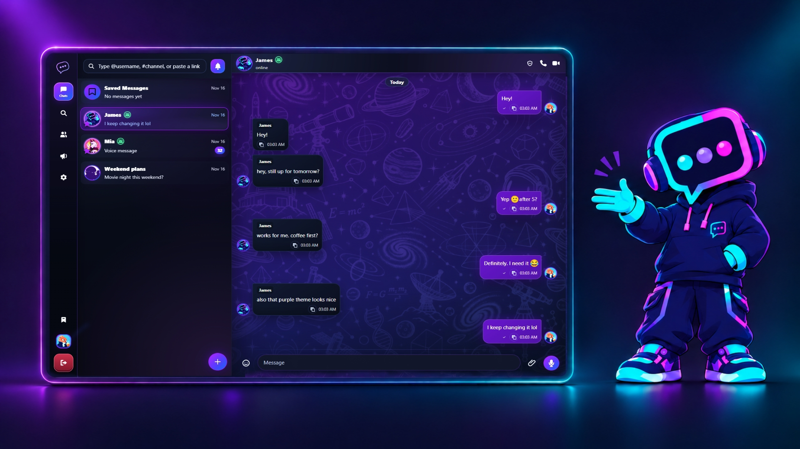
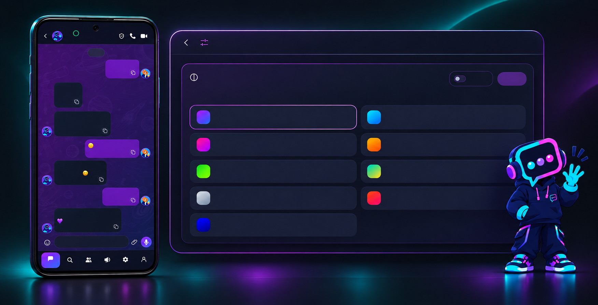

<h1 align="center">ChatBox | چت‌باکس</h1>

<b>گفت‌وگوهای خودت، با رنگ‌و‌حال خودت</b>

<a href="https://chatbox.hooman009.ir">ورود به چت‌باکس</a> · <a href="https://github.com/hooman009dev/ChatBox/releases/latest">دانلود اپ‌ها</a> · <a href="README.md">English</a> · <a href="https://hooman009.ir">سایت سازنده</a>

## یه فضای آشنا، با سلیقهٔ خودت

تمی رو که دوست داری انتخاب کن، با دوستات گپ بزن، ویس بفرست یا عکس و فایل به اشتراک بذار. چت‌باکس روی ویندوز، اندروید و مرورگر همراهته.

برای کاربرهای ایرانی، با توجه به ارتباط در شبکه‌های داخلی و رابطی که با فارسی و انگلیسی راحته.

### ظاهرش رو خودت انتخاب کن

از آمتیست و فیروزه‌ای تا تم‌های رنگی دیگه؛ والپیپر دلخواهت رو بذار و میزان حرکت‌های رابط رو با سلیقه و توان دستگاهت تنظیم کن.

### گفت‌وگو فقط نوشتن نیست

پیام، ویس، ایموجی، عکس، فیلم و فایل؛ کنار گفت‌وگوی خصوصی، گروه‌ها و کانال‌ها هم هستن. پیش‌نمایش رسانه، نمایش حجم و مدیریت دانلودها کمک می‌کنن انتخاب دست خودت باشه.

### فارسی و انگلیسی، روی صفحهٔ بزرگ و کوچیک

رابط چت‌باکس برای متن‌های راست‌به‌چپ و چپ‌به‌راست و اندازه‌های مختلف صفحه آماده شده.

## دانلود نسخهٔ مناسب دستگاهت

- [دانلود نصب‌کنندهٔ ویندوز x64](https://github.com/hooman009dev/ChatBox/releases/download/v1.1.3/ChatBox-Setup-1.1.3-build123-x64.exe)
- [دانلود APK اندروید](https://github.com/hooman009dev/ChatBox/releases/download/v1.1.3/ChatBox-1.1.3-build123.apk)
- [استفاده از نسخهٔ وب](https://chatbox.hooman009.ir)

شمارهٔ نسخه، تغییرات و شناسهٔ سلامت فایل‌ها توی صفحهٔ انتشار هستن. برای نصب APK ممکنه اندروید تأیید نصب رو ازت بخواد.

## چت‌باکس پرمیوم ⭐

به دوستت زنگ بزن، دوربینت رو روشن کن، صفحه‌ت رو نشون بده یا با **سینمای مطلق** با هم فیلم ببینین. این امکانات با چت‌باکس پرمیوم در دسترسن.

## تصاویر واقعی رابط

یه نگاه نزدیک‌تر به چت‌باکس روی دسکتاپ و موبایل:

- [گفت‌وگو روی دسکتاپ](assets/chat-desktop-real.png)
- [ظاهر و کیفیت](assets/appearance-real.png)
- [گفت‌وگو روی صفحهٔ کوچیک](assets/chat-android-layout-real.png)

## تغییرات نسخهٔ جدید

[چنج‌لاگ ۱.۱.۳](CHANGELOG.md) شامل تغییرات عادی و پرمیوم، جدا از هم نوشته شده.

## ساختهٔ hooman009

**چت‌باکس:** [chatbox.hooman009.ir](https://chatbox.hooman009.ir)  
**سایت سازنده:** [hooman009.ir](https://hooman009.ir)  
**گیت‌هاب:** [hooman009dev](https://github.com/hooman009dev)  
**راهنما و بازخورد:** [پشتیبانی](SUPPORT.md)

## مجوز استفاده

© ۲۰۲۶ **hooman009** · [مجوز استفاده](LICENSE)

