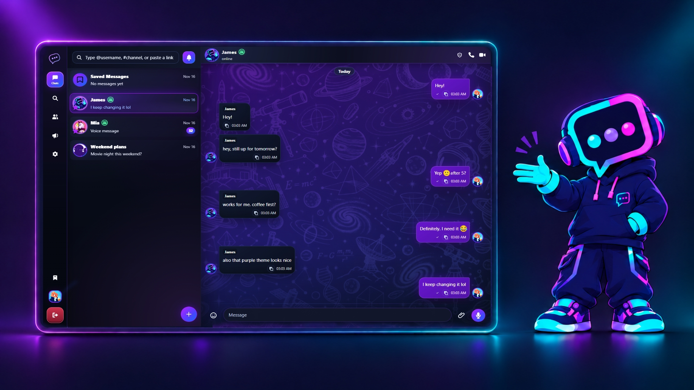
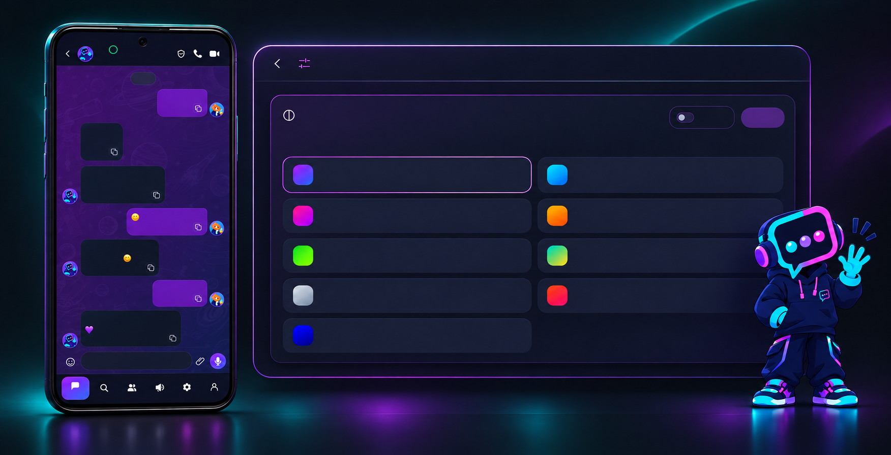

<h1 align="center">ChatBox</h1>

<b>Your conversations. Your colors.</b> گفت‌وگوهای خودت، با رنگ‌و‌حال خودت

<a href="https://chatbox.hooman009.ir">Open ChatBox</a> · <a href="https://github.com/hooman009dev/ChatBox/releases/latest">Download apps</a> · <a href="README.fa.md">فارسی</a> · <a href="https://hooman009.ir">Meet the creator</a>

<b>Windows x64 · Android · Web</b> Created by <a href="https://hooman009.ir">hooman009</a>

## A little more you, in every conversation

Pick the theme that feels right today. Catch up with a friend, send a voice message, share a photo, or keep your group in the loop. ChatBox brings those everyday moments together in a colorful space, across your computer, phone and browser.

Made with Iranian users and local connectivity in mind, with Persian and English side by side.

<table>
<tr><td width="50%"><h3>Make it yours</h3>Choose a theme, change your chat wallpaper and tune the motion to your device.</td><td><h3>Stay in the conversation</h3>Private chats, friends, groups and channels, with message tools that keep things organized.</td></tr>
<tr><td><h3>More than text</h3>Voice messages, emoji artwork, photos, videos and files. Preview media, see transfer sizes and manage downloads.</td><td><h3>At home in both languages</h3>Persian and English, with right-to-left and left-to-right layouts on large and small screens.</td></tr>
</table>

## Choose your screen

| Windows | Android | Browser |
| --- | --- | --- |
| [Windows installer](https://github.com/hooman009dev/ChatBox/releases/download/v1.1.3/ChatBox-Setup-1.1.3-build126-x64.exe) | [Android APK](https://github.com/hooman009dev/ChatBox/releases/download/v1.1.3/ChatBox-1.1.3-build126.apk) | [Open ChatBox](https://chatbox.hooman009.ir) |
| Amethyst setup for Windows x64 | The official Android package | Start from your browser |

The [release page](https://github.com/hooman009dev/ChatBox/releases/latest) includes version details and file checksums. Android may ask you to approve installation through its system installer.
